# Atlas de motion para direção e storyboard

23 estudos visuais consultados em 20/11/2026. Para uma abertura, procure uma referência que resolva a entrada e outra que resolva a leitura do quadro final. Para ensinar um gesto, comece pelas duplas ação–resposta de Motion e pelas chamadas de interface do Opus.

| Decisão no storyboard | Onde começar |
|---|---|
| Dois objetos passam a formar um símbolo | [TeamViewer](#pin-teamviewer), [ponto e fita](#pin-borboleta) |
| O nome se escreve ou ganha volume | [Traços em camadas](#codrops-traco), [massa de cor](#opus-blob-to-wordmark) |
| Um detalhe da interface precisa conduzir a leitura | [Chamadas](#opus-callout-labels), [pressão prolongada](#motion-press-hold) |
| Há uma relação de causa ou uma escolha | [Cadeia](#opus-cause-effect-chain), [árvore editorial](#fx-editorial-insights) |
| Um corte introduz o próximo capítulo | [Faixa horizontal](#opus-channel-intro-sting), [horizonte](#opus-brush-stroke-reveal) |

As folhas com seis quadros mostram amostras de vídeos decodificados, lidas da esquerda para a direita, de cima para baixo. Os tempos impressos são posições de consulta no arquivo. As pranchas e capas preservam o material estático publicado pela fonte. As sugestões abaixo são decisões para uma nova peça. Os créditos dos pins identificam o post quando a autoria original não foi confirmada. Os direitos sobre as imagens e as marcas pertencem aos respectivos titulares. Use ativos próprios ou licenciados na execução final.

## Logos encontrados no Pinterest

### Dois dispositivos viram uma assinatura

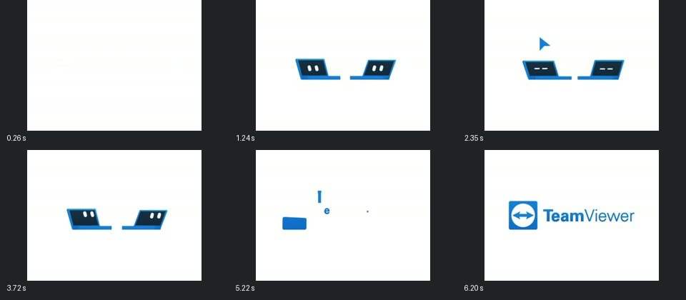

Dois notebooks ocupam lados opostos do quadro a 1,24 s. Um ponteiro aparece entre eles. A 5,22 s restam fragmentos azuis e, a 6,20 s, símbolo e nome compartilham a linha de base. [Vídeo ou demonstração de origem](https://www.pinterest.com/pin/293859944456456102/) · [Clipe consultado](https://v1.pinimg.com/videos/mc/720p/64/85/2f/64852fb992f74ee3469856cf0757050f.mp4)

Para abrir uma aula sobre comunicação, desenhe dois dispositivos próprios e faça o indicador de mensagem atravessar o espaço entre eles. Preserve esse eixo na passagem para a cartela. Congele o meio da cena e confira se a origem e o destino continuam distintos.

### Um emblema desenhado por segmentos

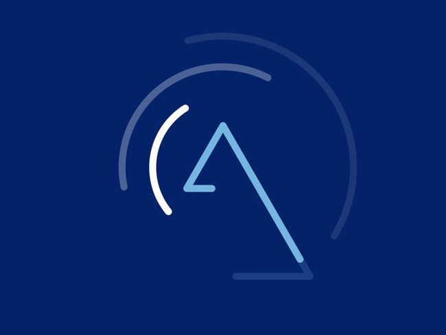

O cartaz reúne um arco branco, arcos azuis atenuados e uma linha angular aberta. O centro vazio separa o arco do desenho interno. [Imagem e contexto de origem](https://www.pinterest.com/pin/30258628738853200/) · [Imagem consultada](https://i.pinimg.com/736x/4a/1b/ff/4a1bff1e7ca67687d5b7695a3f006035.jpg)

Para uma abertura técnica, escolha quais trechos de um ícone desenhar e em que ordem. Comece pelo traço que identifica a forma e revele o detalhe depois. Teste a silhueta no menor tamanho de exibição. A ordem sugerida é uma adaptação do cartaz.

### Espiral com centro de leitura

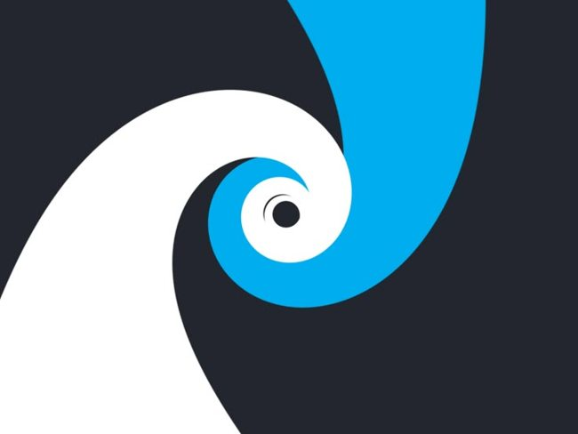

Na imagem publicada, duas faixas largas, branca e azul, convergem para um pequeno círculo escuro. O contraste mantém o centro visível mesmo com grande parte da espiral fora do quadro. [Imagem e contexto de origem](https://www.pinterest.com/pin/210684088813163883/) · [Imagem consultada](https://i.pinimg.com/736x/3f/15/df/3f15dfed51d9b45e0789c4a03aef55f2.jpg)

Para passar do plano geral ao detalhe, fixe o centro da espiral no ponto que deverá receber a atenção na próxima cena. Termine a máscara antes de mostrar uma palavra que precise ser lida. A direção da rotação fica a cargo da peça.

### Órbita curta para uma revelação de marca

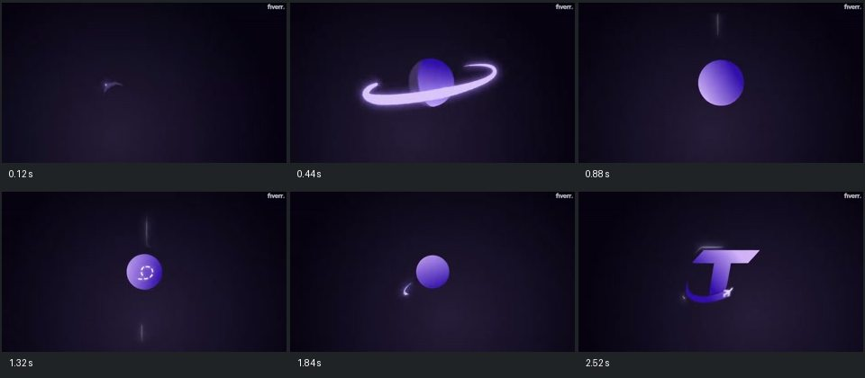

No primeiro trecho da compilação, um arco luminoso envolve uma esfera a 0,44 s. A esfera fica isolada a 0,88 s e um monograma ocupa o mesmo centro a 2,52 s. [Vídeo ou demonstração de origem](https://www.pinterest.com/pin/293859944456486546/) · [Clipe consultado](https://v1.pinimg.com/videos/iht/expMp4/50/00/83/50008344137f0db0c0217d303df23c79_720w.mp4)

Em uma vinheta de produto, construa a órbita em duas camadas para que passe por trás e pela frente do objeto. Diminua o brilho antes do repouso. O símbolo final precisa preservar o desenho autorizado e continuar reconhecível num quadro estático.

### Luz para descrever relevo

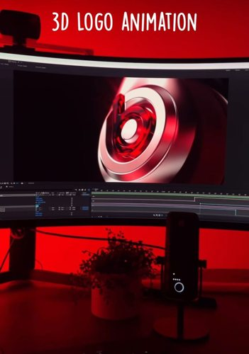

A capa é uma fotografia de um monitor. Nele, um emblema circular tem bordas claras e cavidades escuras sob luz vermelha. A evidência permite estudar iluminação e profundidade. [Imagem e contexto de origem](https://www.pinterest.com/pin/63754150968936505/) · [Imagem consultada](https://i.pinimg.com/736x/2a/52/31/2a52315afe1c04ccf539b184259e9ebf.jpg)

Para uma assinatura 3D, experimente uma passagem lateral de luz sobre uma marca própria. Antes de animar a câmera, faça duas provas fixas de luz e confira se o vão entre as peças continua aberto nas duas.

### De um gesto geométrico à assinatura

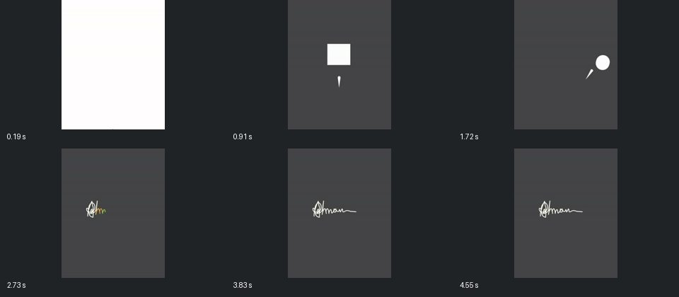

A sequência passa por um quadrado a 0,91 s e um ponto deslocado a 1,72 s. A assinatura começa a aparecer na região central a 2,73 s e ocupa uma faixa horizontal a 3,83 s. [Vídeo ou demonstração de origem](https://www.pinterest.com/pin/298011700361641508/) · [Clipe consultado](https://v1.pinimg.com/videos/mc/720p/ec/12/88/ec1288bf236a0fa4b68015a98b783e07.mp4)

Funciona em encerramentos autorais. Use um caminho de escrita próprio para guiar a máscara e mantenha a espessura do traço nos cruzamentos. Reserve o repouso para ler o nome inteiro.

### Da queda do ponto à fita dobrada

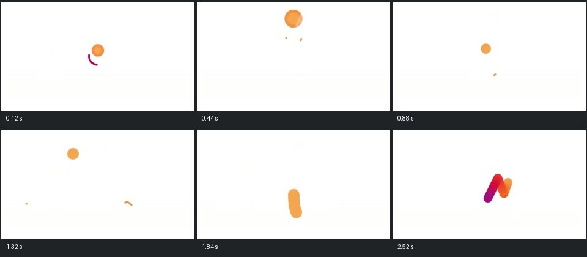

No início da compilação, um ponto laranja sobe, cai e se alonga. Aos 1,84 s tem a forma de cápsula vertical. Aos 2,52 s aparece uma fita dobrada em duas cores. [Vídeo ou demonstração de origem](https://www.pinterest.com/pin/358739926587919221/) · [Clipe consultado](https://v1.pinimg.com/videos/iht/720p/84/14/cf/8414cf42059551fb35df8bb34b48ae07.mp4)

Para uma intro curta e leve, use o ponto como matéria da fita. Escolha uma largura final e faça a ponta seguir a trajetória até a dobra. Compare o quadro de impacto e o final para que a fita pareça vir do mesmo objeto.

## Filmes e componentes em repositórios de motion

### Reel que alterna título e demonstração

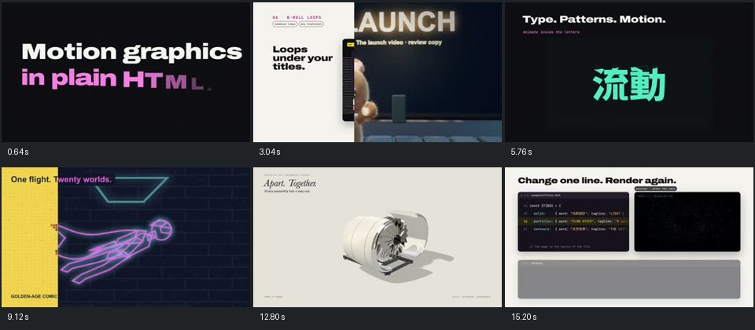

O primeiro quadro é dominado por tipografia. A amostra de 3,04 s divide a tela entre texto e imagem. Mais adiante aparecem um desenho de ação, uma peça mecânica e dois painéis de trabalho. [Vídeo ou demonstração de origem](https://github.com/howardc38/motion-fx-lab/blob/0a5b96ea35f092a3877c6c117f77f564f53a26bb/media/intro.preview.mp4)

Use em um trailer de curso. Monte uma promessa curta, uma evidência visual e uma cartela final. Mantenha uma margem de título comum entre cortes para que o espectador reencontre o texto ao trocar de assunto.

### Da chamada editorial à árvore de decisão

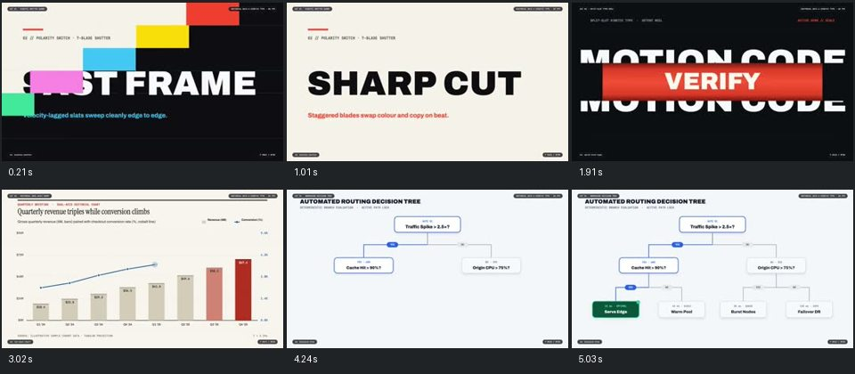

Faixas atravessam a manchete na abertura. A 3,02 s o enquadramento já é um gráfico. Entre 4,24 e 5,03 s a árvore amplia os ramos e destaca uma opção. [Vídeo ou demonstração de origem](https://github.com/howardc38/motion-fx-lab/blob/0a5b96ea35f092a3877c6c117f77f564f53a26bb/media/editorial-insights.preview.mp4)

Para explicar uma decisão, encerre a transição editorial antes da primeira bifurcação. Ancore os nós que o público já leu. No segundo passo, destaque somente a nova aresta e sua consequência.

### Vista explodida com base persistente

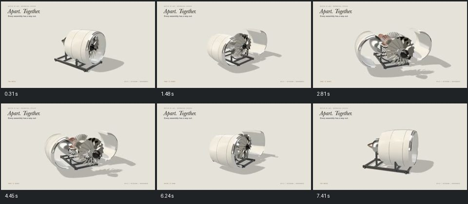

A peça está montada a 0,31 s. A carcaça se afasta e expõe o interior a 2,81 s. No final, o volume volta a fechar sobre a mesma base e sombra. [Vídeo ou demonstração de origem](https://github.com/howardc38/motion-fx-lab/blob/0a5b96ea35f092a3877c6c117f77f564f53a26bb/media/mechanical-assembly.preview.mp4)

Para decompor um sistema, reserve trajetórias separadas aos componentes. Uma vista fixa permite associar cada peça ao seu encaixe. Ao revisar, acompanhe uma peça de ponta a ponta e confira se ela retorna ao mesmo lado.

### Anel de contagem que cede lugar à chamada

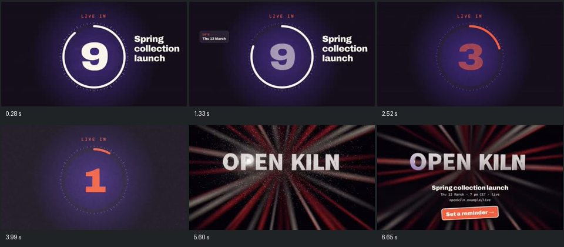

A composição começa com algarismo e arco em um campo escuro. O 3 e o 1 ocupam o mesmo centro. A chamada ocupa a tela quando termina a contagem. [Vídeo ou demonstração de origem](https://github.com/howardc38/motion-fx-lab/blob/0a5b96ea35f092a3877c6c117f77f564f53a26bb/media/countdown.preview.mp4)

Em uma pausa de quiz, use números de largura estável, deixe a pergunta parada e substitua o contador pela explicação na mesma região. Use contagem apenas se o aluno realmente tiver esse tempo para responder.

### Refração como mudança de superfície

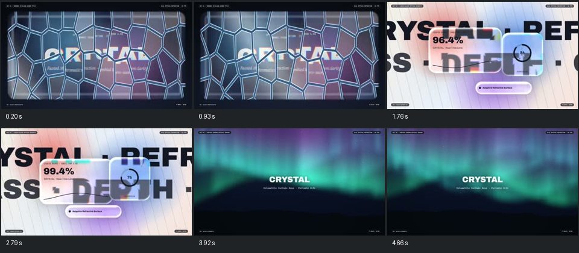

A primeira amostra tem uma malha que distorce o título. A 1,76 s, placas translúcidas estão sobre letras grandes. A 3,92 s, a imagem já repousa numa paisagem com título central. [Vídeo ou demonstração de origem](https://github.com/howardc38/motion-fx-lab/blob/0a5b96ea35f092a3877c6c117f77f564f53a26bb/media/glass-refraction.preview.mp4)

Em um filme de produto, concentre a distorção numa camada de passagem e mantenha o texto de conclusão em camada limpa. No mobile, valide as bordas das letras e os algarismos no quadro de maior refração.

### Chamadas que apontam para uma peça fixa

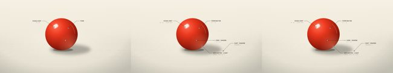

O tríptico mantém uma esfera vermelha na mesma posição enquanto aparecem linhas-guia e legendas ao redor. A sombra ajuda a preservar a orientação. [Imagem e contexto de origem](https://github.com/GovinduSasanka/opus-motion-library/blob/7bde15aa904671fb0a1a06c2d88e7012dbab2069/gallery/callout-labels.jpg)

Para explicar o remetente de uma mensagem, ancore o início da linha no campo correto e coloque o texto fora da interface. Revele primeiro o ponto, depois a linha e por último a legenda. Confira a ancoragem também no recorte móvel.

### Cadeia que ganha uma ramificação

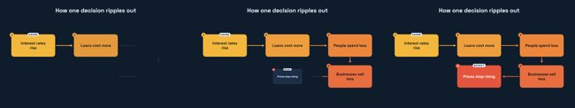

A prancha começa com dois cartões ligados e termina com uma cadeia distribuída em duas alturas. As primeiras caixas ocupam posições reconhecíveis ao longo da sequência. [Imagem e contexto de origem](https://github.com/GovinduSasanka/opus-motion-library/blob/7bde15aa904671fb0a1a06c2d88e7012dbab2069/gallery/cause-effect-chain.jpg)

Para mostrar como uma decisão muda o percurso, abra espaço para o segundo ramo já na composição inicial. Desenhe a ligação até o próximo cartão e só então revele o resultado. Rotule hipóteses como possibilidades.

### Formas curtas, faixa longa e título

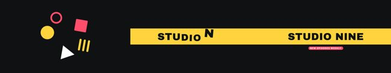

O tríptico passa de formas isoladas sobre preto a uma faixa horizontal amarela. O título ocupa essa faixa e ganha uma segunda linha bem menor. [Imagem e contexto de origem](https://github.com/GovinduSasanka/opus-motion-library/blob/7bde15aa904671fb0a1a06c2d88e7012dbab2069/gallery/channel-intro-sting.jpg)

Para abrir uma série, derive a faixa de um elemento que já está em cena. Pare a expansão quando o texto chegar e mantenha a linha de base fixa. Em uma vinheta recorrente, a segunda linha pode variar por episódio.

### A massa de cor se distribui pelo nome

O primeiro painel contém volumes coloridos juntos. O seguinte apresenta letras volumétricas com a mesma família de cores. No terceiro, o subtítulo ocupa a base. [Imagem e contexto de origem](https://github.com/GovinduSasanka/opus-motion-library/blob/7bde15aa904671fb0a1a06c2d88e7012dbab2069/gallery/blob-to-wordmark.jpg)

Para uma marca de tom lúdico, atribua uma cor ou material a cada grupo de letras antes de planejar a passagem. Valide o desenho frontal do nome e revele o subtítulo quando as letras tiverem repousado.

### Paisagem revelada em faixas

A prancha mantém um horizonte e um sol recorrentes. O primeiro plano ganha extensão e a legenda aparece na região inferior. [Imagem e contexto de origem](https://github.com/GovinduSasanka/opus-motion-library/blob/7bde15aa904671fb0a1a06c2d88e7012dbab2069/gallery/brush-stroke-reveal.jpg)

Para uma transição entre capítulos, use o horizonte como registro entre os dois estados. Anime uma máscara com borda irregular sobre a ilustração. Preserve uma área de contraste uniforme para o título final.

## Aberturas de estúdio e demonstrações de desenvolvedores

### Da grade de construção à identidade

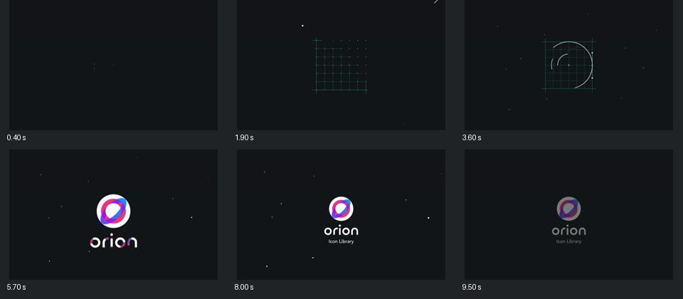

A 1,90 s há uma grade fina. A 3,60 s surgem arcos de construção. O emblema e as letras ocupam o mesmo centro a 5,70 s, e a assinatura está menor a 8 s. [Vídeo ou demonstração de origem](https://tympanus.net/codrops/2023/01/31/bringing-letters-to-life-coding-a-kinetic-svg-typography-animation/) · [Clipe consultado](https://tympanus.net/codrops/wp-content/uploads/2023/01/mamboleoo_kinetic_orion_intro.mp4)

Para uma abertura que apresenta um método, escolha duas guias que expliquem a geometria da marca. Reduza a opacidade das guias quando o símbolo ganhar peso. Compare a leitura do último quadro em tela cheia e como miniatura.

### Lettering com rastros de cor

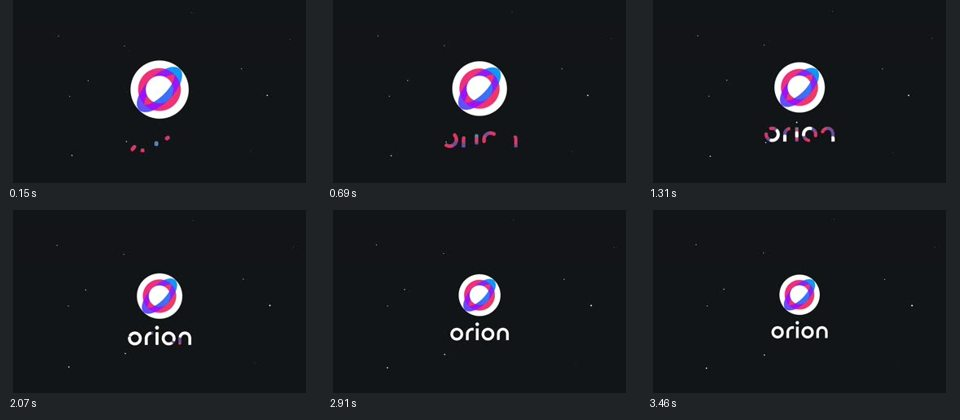

O recorte em câmera lenta mantém o emblema estável. Entre 0,69 e 1,31 s aparecem fragmentos coloridos abaixo. A partir de 2,07 s o nome se lê inteiro. O autor documenta o uso de caminhos SVG duplicados. [Vídeo ou demonstração de origem](https://tympanus.net/codrops/2023/01/31/bringing-letters-to-life-coding-a-kinetic-svg-typography-animation/) · [Clipe consultado](https://tympanus.net/codrops/wp-content/uploads/2023/01/mamboleoo_kinetic_tyopgraphy_logo.mp4)

Em uma assinatura monolinear, divida a escrita nas junções naturais e dê um pequeno atraso ao segundo traço. Use o contorno oficial intacto no repouso. Os tempos da folha pertencem ao recorte desacelerado.

### Storyboard que dá uma trajetória ao símbolo

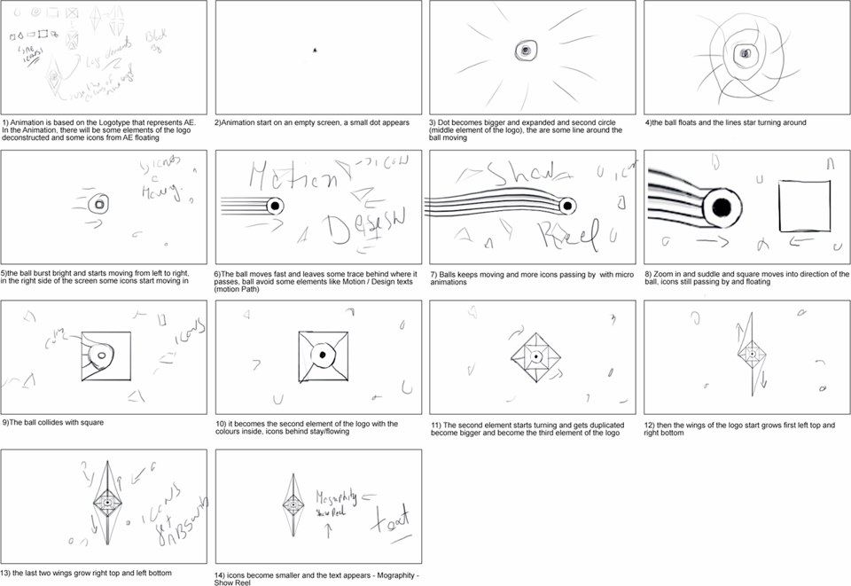

Na prancha do estúdio, o ponto do quadro 2 atravessa a tela nos quadros 6–8, encontra um quadrado no 9 e compõe a marca nos quadros 10–14. A direção da trajetória aparece antes do encontro. [Imagem e contexto de origem](https://mographitystudio.com/pages/project-intro.html) · [Imagem consultada](https://mographitystudio.com/images/IntroMographity_1600_04.png)

Para decidir se uma intro precisa de tantos movimentos, desenhe a origem, o encontro e o destino em três miniaturas. Acrescente um quadro somente quando ele resolver uma dúvida de orientação, de forma ou de leitura.

### Um símbolo para identificar uma série

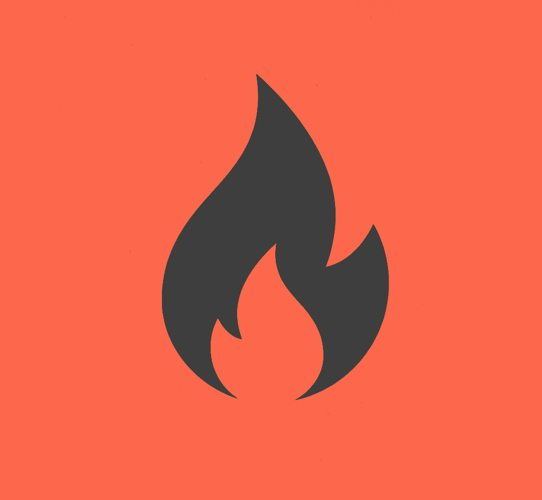

A imagem de apresentação contém uma chama escura recortada sobre um campo coral. O espaço negativo interno mantém a silhueta legível em duas cores. O estúdio identifica o projeto como abertura de uma série de entrevistas. [Imagem e contexto de origem](https://thesevenoaksanimator.com/portfolio/in-the-hot-seat-title-sequence/) · [Imagem consultada](https://thesevenoaksanimator.com/wp-content/uploads/2024/09/HotSeat-1.jpg)

Para identificar uma série em poucos instantes, procure um objeto recorrente do assunto e desenhe sua menor silhueta reconhecível. Faça um teste de entrada com máscara e segure o ícone junto ao título. O movimento sugerido parte da imagem estática.

### Pressão, progresso e confirmação

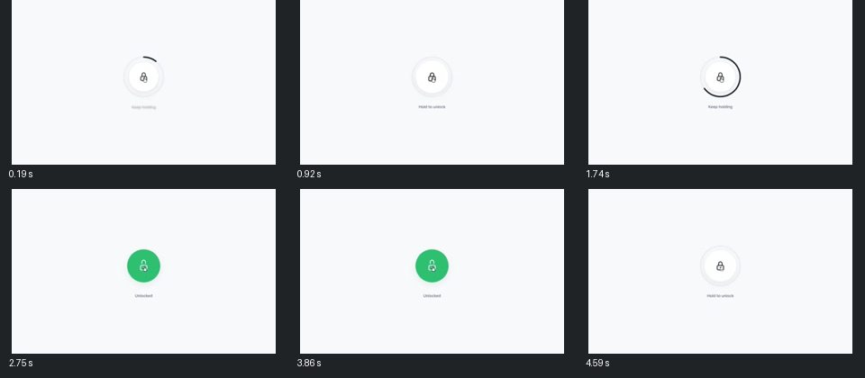

O círculo externo se preenche ao redor do cadeado. Na amostra de 2,75 s o botão está verde e, a 4,59 s, voltou à aparência inicial. A demonstração de Matt Perry associa completar o anel ao gesto de segurar. [Vídeo ou demonstração de origem](https://motion.dev/examples/react-press-hold) · [Clipe consultado](https://images.motion.dev/examples/stage/react/press-hold/v-465f103097da/thumb.mp4)

Em um tutorial de uma interface que realmente exige pressão prolongada, acumule o tempo apenas enquanto houver contato. Antecipe também o cancelamento. A confirmação visual deve ocorrer quando a ação se completa.

### Rotação guiada por um valor comum

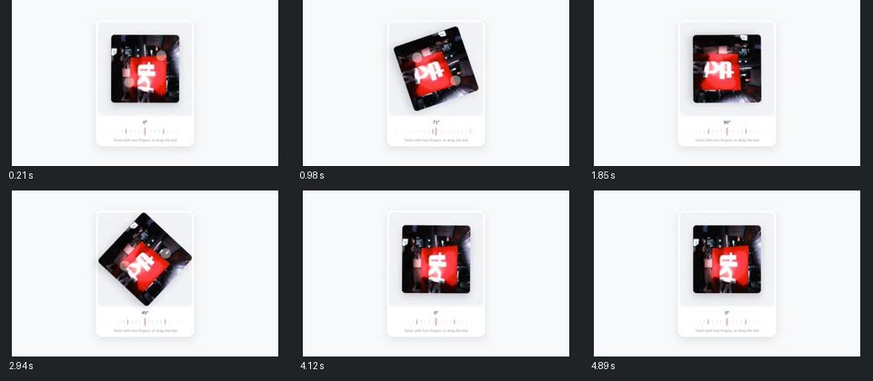

A foto gira dentro de um quadro estável e se realinha. A régua abaixo permanece no campo de visão. A implementação publicada liga foto, graduação e leitura numérica ao mesmo valor angular. [Vídeo ou demonstração de origem](https://motion.dev/examples/react-pinch-rotate) · [Clipe consultado](https://images.motion.dev/examples/stage/react/pinch-rotate/v-cb006a257525/thumb.mp4)

Para ensinar uma manipulação direta, anime o objeto e seu indicador pelo mesmo parâmetro. Mantenha a moldura fixa durante a soltura e verifique se imagem e graduação pousam juntas no ângulo final.

## Aplicação às aulas BeSafe

Para explicar a verificação de um remetente, comece com o e-mail fictício em escala de leitura. Preserve o assunto quando a linha da caixa de entrada se expandir para a mensagem. Use a chamada da esfera vermelha como referência de ancoragem para destacar o domínio. Quando o domínio e a legenda estiverem legíveis, segure a composição durante a frase correspondente. Se o roteiro introduzir uma decisão, aproveite o espaço livre para abrir o segundo ramo, como no tríptico de causa e efeito. Os pixels da aula vêm da interface ilustrativa e dos ativos autorizados da BeSafe.

Na revisão, pause antes da expansão, durante o deslocamento e depois do repouso. Nos três quadros, localize o mesmo assunto. No último, confira o domínio letra por letra e veja se a linha-guia termina nele mesmo depois do redimensionamento.
